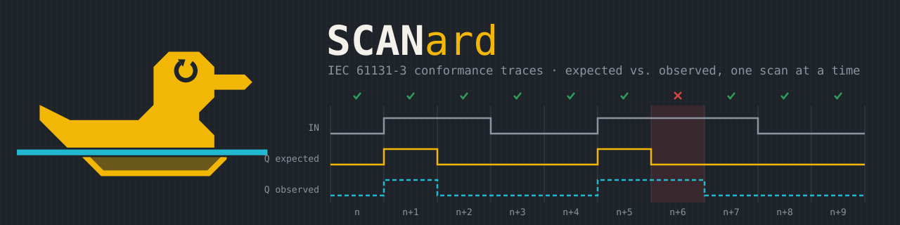

<p align="center"></p>

# IEC 61131-3 conformance traces

[](https://github.com/s-celles/iec61131-conformance/actions/workflows/ci.yml)

An open, runtime-agnostic conformance test suite for IEC 61131-3 Structured
Text runtimes: plain `.st` programs paired with plain-text expected
input/output traces, one record per scan cycle. Dedicated to the public
domain under CC0 1.0 (see `LICENSE`).

Status: 89 tests, run against IronPLC, matiec, OpenPLC's matiec fork, STruC++,
4diac (IDE + FORTE, on the subset 61499 can pose), rk and RuSTy
(see `notes/comparison.md`), with a Lean 4 model of the function block
semantics that the expected traces are proved to follow from.

## Method, and what the results do and do not mean

- The expected values of a `status: conformant` trace are derived by hand
  from the text of IEC 61131-3 (edition 2, 2003, and edition 3, 2013:
  the function block bodies and timing diagrams of its tables, the formulas
  of its standard functions, the semantics clauses of ST). Each `.trace`
  states the derivation and the clause it rests on. That is one reading of
  the standard by one author; it is not a certification, and neither IEC
  nor PLCopen is involved. Where the text leaves a value to the
  implementer (the counters' limits PVmin and PVmax, NOTE under ed.3 table
  46) the trace does not check it. A reading can be wrong: `F_TRIG` at
  start-up and the counters' limits were, and were corrected from the text
  of ed.3 tables 45 and 46 (`notes/findings.md` #6, #7).
- The suite was written with AI assistance (Claude Code; the commits say
  `Assisted-by: AI`). Every derivation was checked against the standard's
  text by the author, but an error in a trace is possible: a runtime that
  fails a trace is a claim to verify against the cited clause, not a
  verdict. If you read a clause differently, open an issue with the clause.
- `status: implementation-defined` traces record what one runtime (IronPLC)
  does on a corner the standard leaves open. They carry no normative weight;
  `SAME`/`DIFFERS` only says whether another runtime made the same choice.
- The results are for the runtime commits pinned in `.github/workflows/ci.yml`
  and say nothing about later versions. They are not a ranking: the
  runtimes target different editions and scopes, and some failures are
  missing features rather than wrong answers (the notes distinguish them).
- The harnesses are simulated-clock drivers written here, not the projects'
  own tooling. A result marked `ERROR` is a limit of the harness or of the
  build, not of the runtime; a `FAIL` on a construct the harness cannot
  express would be an error in this suite, and is what the notes are for.
- `tools/fuzz` generates programs whose expected trace comes from a small
  reference evaluator rather than from the text; those traces are never
  committed. A divergence found there becomes a test only after a hand
  derivation like the others.

## Layout

```
SPEC.md                   the .trace format (header + one record per cycle)
conformance/
  timers/      ton tof tp                        TON, TOF, TP
  edge/        r_trig f_trig sr_rs              edge detectors and bistables
               power_on_clk_true                 ... started with CLK TRUE
  counters/    ctu ctd ctud                     CTU, CTD, CTUD
               ctd_bounds ctud_bounds           ... at the INT bounds
  ops/         precedence std_functions         operators, ABS MIN MAX LIMIT SEL MUX
               std_functions_ext conversions    extensible/formal calls, *_TO_*
               time_arith literals bit_ops      TIME + - < =, literals, SHL SHR ROL ROR AND OR XOR NOT
               real_arith real_functions        REAL + - * /, SQRT ABS EXP LN SIN COS
               real_power real_conversions      EXPT and **, INT/DINT/UINT <-> REAL/LREAL
               real_compare lreal_precision     comparisons, binary64 at full precision
               date_time trunc                  DATE/TOD/DT arithmetic and conversions, TRUNC
               limit_inverted std_functions_expr LIMIT with MN > MX, MUX/SEL/NOT on expressions (from tools/fuzz)
               bit_literals bit_expr_operands   16# literals as BYTE/WORD, NOT/SHL/ROL on expressions (from tools/fuzz)
               shl_width                        SHL truncates to the width of its input (from tools/fuzz)
               time_mul time_functions          TIME * INT with large products, MIN/MAX/LIMIT/SEL/MUX/LT on TIME (from tools/fuzz)
               mux_types                        MUX on UINT, BYTE, WORD, BOOL, TIME
  data/        array_internal array_init        arrays (negative bounds, initialisers)
               struct_internal enum             structures (copy, nesting), enumerations
               array_2d array_of_struct         2-D array, array of a named array type, array of structures
               defaults                         default initial values of every type
  strings/     literals_escapes declared_length STRING literals and $ escapes, STRING[n]
               functions compare concat_assign  LEN CONCAT LEFT RIGHT MID INSERT DELETE REPLACE FIND, < =, copies
  config/      globals_external                 VAR_GLOBAL / VAR_EXTERNAL (SPEC version 2: the .st has
               two_periods priority_order       its CONFIGURATION); task intervals, PRIORITY order,
               global_exchange event_single     producer/consumer through a global, SINGLE task
  control-flow/ if_case for_exit while          IF/CASE, FOR+EXIT, WHILE/REPEAT
               nested_exit case_expr            EXIT in nested loops, CASE on an expression
               return continue for_step         RETURN, CONTINUE (ed.3), FOR BY -n and empty ranges
  pou/         function_call fb_two_instances   functions, FB instances
               fb_input_retention fb_input_defaults  FB inputs kept across calls, initial values
               function_var_not_retained fb_var_temp FUNCTION VAR and VAR_TEMP are not retained
               fb_en_eno                        implicit EN/ENO on a function block
               fb_in_out function_var_output    VAR_IN_OUT (FB and function), function VAR_OUTPUT (=>)
               function_input_default fb_method omitted function inputs, METHOD (ed.3)
  undefined/   int_overflow div_zero eval_order ton_pt_change
               for_bound_modified ctu_pv_zero   corners the standard leaves open
               for_var_after_loop timer_pt_zero
               abs_int_min dint_to_int_overflow
               array_out_of_bounds real_div_zero real_to_int_ties
               string_truncate string_conversions
               tasks_same_priority short_circuit
               subrange_out_of_range
harness/
  ironplc/     Rust: drives the ironplc_vm crate with simulated time
  matiec/      Python: iec2c + generated C driver with simulated time (also
               drives the matiec fork bundled in OpenPLC_v3)
  strucpp/     Python: strucpp (ST -> C++) + generated C++ driver with simulated time
  rk/          Rust: rk compile -> core.wasm, hosted on wasmtime with a simulated
               clock, variables by name through rk's debug_format crate
  4diac/       Python: PROGRAM -> 61499 basic FB (.fbt), 4diac IDE headless export
               to C++ (forte_ng), generated driver against libforte (no clock)
  rusty/       Python: plc (RuSTy) + mock-time stdlib + C driver
formal/        Lean 4: executable FB semantics, trace theorems, properties
tools/fuzz/    differential fuzzing: random well-defined programs + driver (not CI)
notes/
  ironplcvm-io.md   how ironplcvm can (and cannot) be driven from outside
  comparison.md     differential results between the runtimes (table generated
                    from evidence/ by harness/summarize.py)
  findings.md       IronPLC behaviours that differ from the standard/others
  evidence/         full harness outputs
```

Each test is `<name>.st` + `<name>.trace`. Seventy-one tests under the first
nine categories are `status: conformant`: their expected values were derived
by hand from the standard's function block bodies and timing diagrams, and
the derivation is written as a comment at the top of each `.trace` file.
The sixteen tests under `undefined/` are `status: implementation-defined`: the
trace records what IronPLC actually does, and the comment states what the
standard says or leaves open; a mismatch on another runtime is a documented
difference, not a failure.

Scope: BOOL, INT, DINT, UINT, TIME, BYTE, WORD, DWORD, REAL, LREAL at the
program interface, STRING as an output (arrays, structures and enumerations
inside the program); one program on one cyclic task, or (SPEC version 2,
`config/`) a CONFIGURATION with several tasks and program instances; no
located variables.

## Continuous integration

`.github/workflows/ci.yml` runs on every push and pull request:

- `formal`: checks `Traces.lean` is up to date with the `.trace` files, then
  `lake build` (the proofs are the only hard gate: a `.trace` that no longer
  follows from the model fails the build).
- `ironplc`, `matiec`, `openplc` (the matiec fork in OpenPLC_v3), `strucpp`
  (STruC++, built from source with Node 22): build the runtime at the commit
  recorded in
  `notes/evidence/COMMANDS.md`, run the suite with `--record`, and diff the
  output against `notes/evidence/<runtime>-run.txt`. The runtimes are known
  to fail some conformant tests (`notes/findings.md`), so the harness exit
  status is not the gate; what must not change silently is the recorded
  result. If a change to a test or harness alters it, regenerate the
  evidence file in the same commit and run `python3 -I harness/summarize.py`
  to refresh the results table of `notes/comparison.md` (checked by CI).
- `rusty`: same, on pull requests, weekly and on `workflow_dispatch` (needs
  LLVM 21 and a full RuSTy build; skipped on plain pushes to `main`).
- `rk`: rk built from source at `RK_SHA` (cached), the wasmtime host in
  `harness/rk`.
- `fourdiac`: the 4diac IDE 3.3.0 Linux package and FORTE 3.3.0 built as
  shared libraries, both cached; the IDE runs under `xvfb-run`.

To bump a runtime, update its SHA in the workflow `env` and the evidence
file together.

## Running against IronPLC

The harness links the `ironplc_vm` crate directly because the `ironplcvm`
command line has no way to inject inputs or simulate time
(`notes/ironplcvm-io.md`). It expects an IronPLC checkout, built, reachable
through a symlink `ironplc-src` at the suite root:

```sh
git clone https://github.com/ironplc/ironplc
(cd ironplc/compiler && cargo build --release --bin ironplcc --bin ironplcvm)
ln -s $PWD/ironplc iec61131-conformance/ironplc-src
cd iec61131-conformance
(cd harness/ironplc && cargo build --release)
./harness/ironplc/target/release/iec61131-conformance-ironplc \
    --ironplcc ironplc-src/compiler/target/release/ironplcc conformance
```

`--record` prints what the VM produced in `.trace` record syntax (that is how
the `undefined/` traces were written). Exit status 1 if any conformant test
fails, so the command is CI-ready.

## Running against matiec

```sh
git clone https://github.com/beremiz/matiec && (cd matiec && ./configure && make)
python3 -I harness/matiec/run.py --iec2c matiec/iec2c --matiec-lib matiec/lib conformance
```

## Running against OpenPLC's matiec fork

OpenPLC_v3 bundles its own, older, matiec (`utils/matiec_src`). The same
harness drives it; only the paths change:

```sh
git clone --depth 1 https://github.com/thiagoralves/OpenPLC_v3 openplc
(cd openplc/utils/matiec_src && autoreconf -i && ./configure && make)
python3 -I harness/matiec/run.py --iec2c openplc/utils/matiec_src/iec2c \
    --matiec-lib openplc/utils/matiec_src/lib conformance
```

## Running against STruC++

STruC++ (Autonomy-Logic/STruCpp, the ST to C++ compiler of OpenPLC Runtime
v4) is a TypeScript program with a header-only C++14 runtime:

```sh
git clone https://github.com/Autonomy-Logic/STruCpp strucpp
(cd strucpp && npm ci --ignore-scripts && npx tsc && node scripts/rebuild-libs.mjs)
python3 -I harness/strucpp/run.py --strucpp "node strucpp/dist/node/cli.js" \
    --runtime-include strucpp/src/runtime/include conformance
```

The harness drives the compiled programs with its own driver; for a
`CONFIGURATION` it runs the periodic tasks the way STruC++'s own REPL loop
does (declaration order, priority ignored) and does not drive `SINGLE` tasks.

## Running against RuSTy

See `harness/rusty/README.md`.

## Running against rk

rk (github.com/adclz/rk) compiles Structured Text to WebAssembly and ships
no runtime; the harness is the host.

```sh
git clone https://github.com/adclz/rk scratch/rk
(cd scratch/rk && git checkout 20761dd && cargo build --release -p rk)
(cd harness/rk && cargo build --release)
./harness/rk/target/release/iec61131-conformance-rk --rk scratch/rk/target/release/rk conformance
```

Each test becomes an rk workspace; the harness prepends one line of `USING`
for rk's `Std.*` namespaces and appends a one-task CONFIGURATION to a bare
PROGRAM (see `notes/comparison.md`, rk section).

## Running against 4diac

Needs the 4diac IDE (3.3.0; the `.app` on macOS or the unpacked
`.tar.gz` on Linux — its bundled JRE is used) and FORTE 3.3.0 built as a
shared library:

```sh
git clone -b 3.3.0 https://github.com/eclipse-4diac/4diac-forte scratch/4diac-forte
cmake -S scratch/4diac-forte -B scratch/4diac-forte/build -DFORTE_ARCHITECTURE=Posix \
    -DFORTE_BUILD_EXECUTABLE=OFF -DBUILD_SHARED_LIBS=ON -DCMAKE_BUILD_TYPE=Release \
    -DFORTE_MODULE_IEC61131=ON -DFORTE_MODULE_CONVERT=ON -DFORTE_MODULE_UTILS=ON \
    -DFORTE_COM_ETH=OFF -DFORTE_COM_FBDK=OFF -DFORTE_COM_LOCAL=ON
cmake --build scratch/4diac-forte/build -j8
python3 -I harness/4diac/run.py --ide /path/to/4diac-ide.app \
    --forte-src scratch/4diac-forte --forte-build scratch/4diac-forte/build conformance
```

The IDE is launched once (all tests as projects of one workspace, one Ant
export), then once more per FB it refused, so a full run takes a few
minutes. Only PROGRAM-only tests over elementary types and FUNCTIONs are in
scope; the rest is reported as `ERROR` with the reason.

## Checking the formal model

```sh
cd formal && lake build          # Lean 4, no Mathlib needed
python3 -I formal/gen_traces.py  # regenerate Traces.lean after editing a .trace
```

`formal/Conformance/Semantics.lean` is an executable model of TON, TOF, TP,
R_TRIG, F_TRIG, SR, RS, CTU, CTD and CTUD as one-cycle state machines, and of
a configuration's task scheduler (periodic and SINGLE tasks run in priority
order, declaration order on ties) applied to the `config/` tests.
`formal/Conformance/Proofs.lean` proves, by evaluation, that each
`status: conformant` trace of those blocks is exactly the model's output,
and proves general properties (TON Q implies ET = PT, TOF never pulses at
power-up, TP never retriggers while IN stays TRUE, edge detectors never fire
twice in a row, SR/RS dominance, CTU reset dominance). Two readings are
parameters of the model, and both are proved to give different traces:
the counters' limits (the INT range, or PV and 0; ed.3 table 46 leaves them to the implementer) and `F_TRIG`'s initial
`M` (the standard's FALSE, per ed.3 table 45, versus the TRUE some runtimes
use).

What the proofs do not do: they do not prove the model is the standard. The
standard text is not in this repository; the model transcribes the
derivations written in the `.trace` comments, with the assumptions named
there (`F_TRIG` initial `M` FALSE per ed.3 table 45, discrete-time evaluation
at `t = cycle * period`).

## Writing a new test

1. Write the program with one `PROGRAM`, inputs in `VAR_INPUT`, outputs in
   `VAR_OUTPUT`, no `CONFIGURATION`.
2. Write the trace by hand from the standard. Say in the comment which
   clause, table or figure the expectation comes from, and which behaviour
   you assumed where the text is silent. `?` is allowed for a value the
   text leaves open, and must be justified.
3. Run it on at least two runtimes before calling it conformant. If they
   disagree, the comment should say which one the trace follows and why.

## Adding a runtime

A harness is a program that, for each test, compiles the `.st`, then for
each record of the `.trace` writes the inputs, runs exactly one cycle at
the simulated time `cycle * period_ms` (the runtime's clock must be
replaceable: timers read it), reads the outputs and compares them with the
expected values under the rules of `SPEC.md` (REAL tolerance, STRING
escapes, `trap`). The four harnesses here (`harness/`, Rust and Python)
are the models; `harness/strucpp/run.py` is the shortest. To fit the rest
of the repository, a harness should:

- print one verdict line per test, `PASS`/`FAIL` for `conformant` traces
  and `SAME`/`DIFFERS` for `implementation-defined` ones, `ERROR` when the
  test could not be run, followed by detail lines of the form
  `cycle N (trace line L): name expected X, got Y` (or the compiler's
  output), and a final `N tests: ...` summary: `harness/summarize.py`
  reads exactly that;
- offer `--record`, which prints the actual outputs in trace syntax so a
  new `implementation-defined` trace can be filled;
- be driven by a CI job that builds the runtime at a pinned commit, runs
  the suite through `.github/scripts/check-evidence.sh` and uploads the
  output; the recorded output goes to `notes/evidence/<runtime>-run.txt`
  (from Linux, since C runtimes differ by platform), the commands to
  `notes/evidence/COMMANDS.md`, a column to `harness/summarize.py`'s
  `RUNTIMES`, and a section of deviations to `notes/comparison.md`.

## Differential fuzzing

`tools/fuzz/gen.py` generates small, well-defined ST programs (profile
`core`: INT and BOOL; profile `time`: also TIME; profile `wide`: also DINT,
UINT, BYTE and WORD with the conversions, bit-string operators and shifts; IF/CASE/FOR; the
operators and standard functions whose meaning the standard fixes
completely) with the expected trace from a reference evaluator; `tools/fuzz/run.py` runs them through the local harnesses and
prints the divergences, keeping the programs for reduction. `--exclude`
leaves out constructs with known upstream issues so that new ones show.
This is a search tool, not part of the suite or of CI.

## Citing

`CITATION.cff` gives the citation metadata (CC0; archive and DOI through
Zenodo once a release is tagged).
