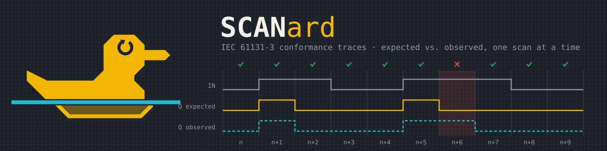

<p align="center"></p>

# IEC 61131-3 conformance traces

[](https://github.com/s-celles/iec61131-conformance/actions/workflows/ci.yml)
[](https://s-celles.github.io/iec61131-conformance/)

An open, runtime-agnostic conformance suite for IEC 61131-3 Structured Text:
plain `.st` programs paired with expected input/output traces, one record
per scan cycle, derived by hand from the text of the standard. The suite runs
against IronPLC, matiec, OpenPLC's matiec fork, STruC++, 4diac, rk and RuSTy,
and a Lean 4 model proves the function block traces. Public domain (CC0 1.0).

**Results, tests and findings: https://s-celles.github.io/iec61131-conformance/**

A failed trace is a claim to check against the clause it cites, not a
verdict. The results cover the runtime commits pinned in CI only.

```
conformance/   the tests: <name>.st + <name>.trace     SPEC.md       trace format
harness/       one driver per runtime                  notes/        results, findings, evidence
formal/        Lean 4 model and trace theorems         tools/        fuzzer, site generator
```

Running the runtimes, the CI, writing a test, fuzzing: [docs/guide.md](docs/guide.md).
Changes: [CHANGELOG.md](CHANGELOG.md). Citation: [CITATION.cff](CITATION.cff).
Written with AI assistance; each derivation was checked against the
standard by the author.
